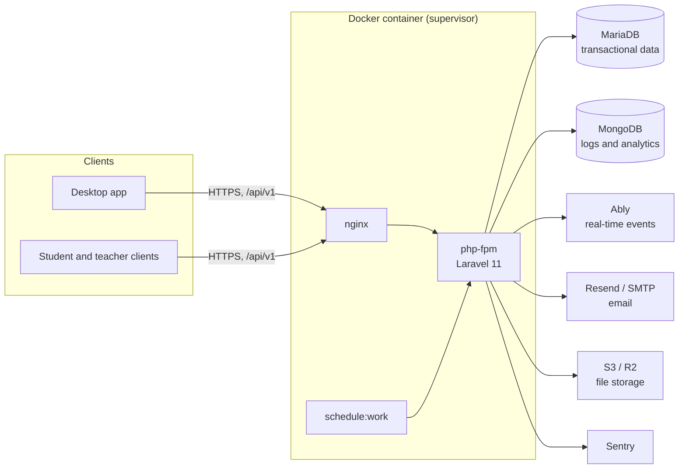
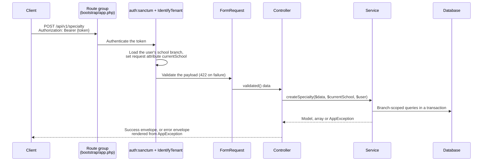
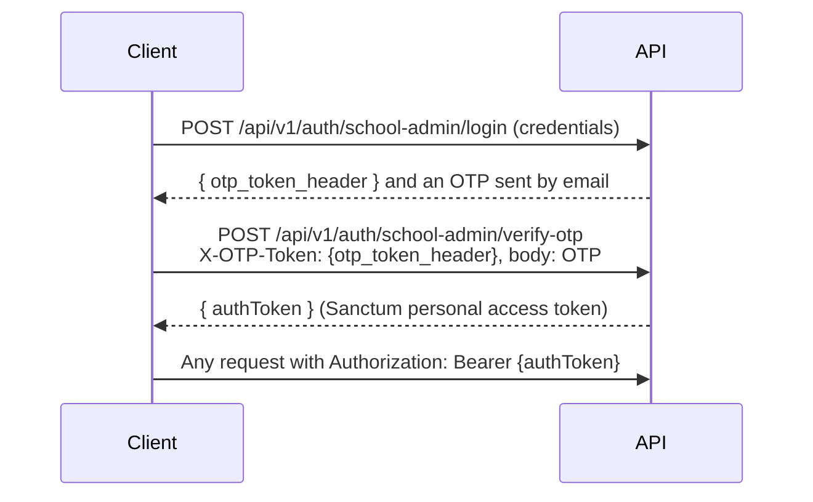

# Smart School Suite API

[](https://github.com/smart-school-suite/school_smart_suite_api/actions/workflows/migration-check.yml)
[](https://github.com/smart-school-suite/school_smart_suite_api/actions/workflows/publish-ghcr.yml)


The REST API behind **Smart School Suite (SSS)**, a multi-tenant school management platform for
secondary and higher-education institutions. One deployment serves many schools: each school
branch manages its own academic structure, people, examinations, fees and communication, isolated
from every other branch.

Its main client is the Smart School Suite desktop application, which lives in a separate
repository. The API also provides sign-in for students and teachers.

---

## Table of contents

1. [Project overview](#project-overview)
2. [Key features](#key-features)
3. [Technology stack](#technology-stack)
4. [System architecture](#system-architecture)
5. [Project structure](#project-structure)
6. [Getting started](#getting-started)
7. [Environment configuration](#environment-configuration)
8. [API documentation](#api-documentation)
9. [Development guidelines](#development-guidelines)
10. [Testing](#testing)
11. [Deployment](#deployment)
12. [Security](#security)
13. [Contributing](#contributing)
14. [License and support](#license-and-support)

Further reading in [`docs/`](docs):
[deployment](docs/deployment.md) · [development workflow](docs/development-workflow.md) · [secrets and configuration](docs/secrets.md)

---

## Project overview

Schools typically run admissions, timetabling, examinations, fee collection and parent
communication in separate tools and spreadsheets. SSS brings these into one system, organised
around a school's academic calendar.

| Audience | What they do with it |
|---|---|
| **School administrators** | Configure the school (departments, specialties, levels, academic years, semesters), manage staff and students, run exams and promotions, bill fees, publish results, run elections |
| **Teachers** | Sign in and receive notifications. Their specialties, courses and availability are recorded for timetabling and invigilation |
| **Students** | Sign in, see their upcoming exams and additional fees, receive notifications, vote in student elections |
| **Platform administrators** | Manage subscription plans, features, activation codes and the schools on the platform |

Parents exist as records managed by administrators, linked to students through guardian
relationships. This API has no parent sign-in routes yet.

## Key features

Every module below has routes, services and persistence in this repository. Endpoint counts are
not listed because they change often; `php artisan route:list` is the source of truth (about 940
routes under `/api/v1`).

| Domain | Capabilities |
|---|---|
| **Academic structure** | Departments, specialties (optionally created across all levels at once), levels and level types, courses and course types, halls, system and school academic years, semesters, student batches |
| **People** | School administrators, teachers (specialties, courses, availability), students, parents and guardian relationships, roles and permissions |
| **Timetabling** | Semester timetables with constraints and versioning, joint courses shared across specialties, exam and resit timetables with versions, diagnostics and errors |
| **Examinations** | Exam types, CA and exam scheduling with update rules, candidates, score entry and evaluation, grade scales and letter grades, results against the minimum passing GPA, result publication |
| **Resits** | Automatic resit records for failed courses, resit fees (standard or by level), resit exams, candidates, scores, timetables and result publication |
| **Promotion and graduation** | Promotion runs with eligibility rules, structured run logs, per-student decisions (single and bulk), graduation batches and records, alumni |
| **Finance** | Registration fees, tuition fees with installment schedules and a transaction ledger, additional fees (with a default due period), fee waivers, resit payments, school expenses, payment methods |
| **Subscriptions** | Plans, features, school subscriptions and payments, activation codes for students and teachers, account limits per plan |
| **Communication** | Announcements (categories, labels, tags, audiences), school events, in-app, email and real-time notifications |
| **Elections** | Election types, offices and roles, applications and candidates, voting, live results over a private channel |
| **Analytics** | Academic, financial and operational statistics, analytics snapshots and time series |
| **School settings** | Per-branch settings with validated handlers: levels, fees, promotion rules, grading, exams, resits, timetables, automatic creation of semesters and academic years |
| **Documents and imports** | PDF generation, spreadsheet imports (students, teachers, school administrators, departments, specialties, courses, halls, grade scales), tracked background jobs |

## Technology stack

| Layer | Technology | Notes |
|---|---|---|
| Language and framework | PHP 8.3, Laravel 11 | `composer.json` pins the platform to PHP 8.3.6 |
| Relational database | MariaDB 10.11 (production), SQLite in memory (tests) | Default connection is read from `MYSQL_DB_CONNECTION` |
| Document database | MongoDB via `mongodb/laravel-mongodb` | Job events, promotion logs, timetable diagnostics and errors, analytics |
| Authentication | Laravel Sanctum | Personal access tokens, one guard per user type |
| Authorization | `spatie/laravel-permission` | Roles and permissions; `role` and `permission` middleware aliases |
| Real-time | Ably (broadcast driver `ably`) | Private channels in [`routes/channels.php`](routes/channels.php) |
| Email | Resend transport, SMTP | Mailers in [`config/mail.php`](config/mail.php) |
| File storage | Local, S3 and Cloudflare R2 disks | [`config/filesystems.php`](config/filesystems.php) |
| Documents and imports | `barryvdh/laravel-dompdf`, `phpoffice/phpspreadsheet` | |
| Content safety | `symfony/html-sanitizer` | Rich-text description fields are sanitized on the server |
| Error monitoring | Sentry (`sentry/sentry-laravel`) | Registered in [`bootstrap/app.php`](bootstrap/app.php) |
| Runtime | Docker (`php:8.3-fpm`), nginx, supervisor | See [Deployment](#deployment) |
| CI/CD | GitHub Actions, GitHub Container Registry, Infisical | See [`docs/deployment.md`](docs/deployment.md) |

**Installed but not yet used by application code.** These packages are in `composer.json` and
may have configuration, but nothing in `app/` uses them yet. Treat them as planned, not available:

- Laravel Scout with Meilisearch: no model is `Searchable`.
- `laravel-clickhouse`, `pusher/pusher-php-server` and `spatie/laravel-medialibrary`.
- `kreait/firebase-php`: `App\Services\FireBaseService` exists but nothing calls it.
- Gemini: `App\Services\Gemini\GeminiClientService` exists but nothing calls it.

## System architecture

The API is a single Laravel application that follows a **controller → service → model** layering,
with a shared-database, row-level multi-tenancy model.



### Request lifecycle



### Layers

| Layer | Location | Responsibility |
|---|---|---|
| Routing | [`bootstrap/app.php`](bootstrap/app.php), [`routes/`](routes) | Each domain has its own route file, registered with its `/api/v1/...` prefix and middleware in `bootstrap/app.php` |
| Middleware | [`app/Http/Middleware`](app/Http/Middleware) | Authentication, tenant resolution, plan limits, account status checks, trusted proxies |
| Validation | [`app/Http/Requests`](app/Http/Requests) | One FormRequest per write operation |
| Controllers | [`app/Http/Controllers`](app/Http/Controllers) | Thin: read the tenant and user, call a service, wrap the result |
| Services | [`app/Services`](app/Services) | Business rules, queries, transactions, events |
| Domain rules | e.g. `app/Services/Exam/ExamUpdatePolicy.php` | Classes that state what may change and why, shared by endpoints and the UI's "update rules" responses |
| Resources | [`app/Http/Resources`](app/Http/Resources) | Shape models for responses |
| Async work | [`app/Jobs`](app/Jobs), [`app/Events`](app/Events), [`app/Listeners`](app/Listeners), [`app/Notifications`](app/Notifications) | Queued jobs, auto-discovered listeners, multi-channel notifications |
| Settings | [`app/SchoolBranchSetting`](app/SchoolBranchSetting) | Per-branch settings: a registry maps each setting key to a handler that validates updates |

### Multi-tenancy

SSS uses **one shared database with row-level tenant isolation**:

- A **school** owns one or more **school branches**. The branch is the tenant.
- Tenant-owned tables carry a `school_branch_id` column.
- The [`IdentifyTenant`](app/Http/Middleware/IdentifyTenant.php) middleware runs after
  `auth:sanctum` on tenant routes. It loads the authenticated user's school branch and stores it on
  the request as the `currentSchool` attribute. If the branch is missing it returns 404.
- Controllers pass `currentSchool` to services, and **every service query is scoped with
  `where('school_branch_id', $currentSchool->id)`**. This scoping is what enforces isolation:
  there is no global query scope, so each new query must apply it explicitly.
- Creating a school administrator is also checked against the branch's subscription limit by
  `LimitSchoolAdmin`, which identifies the branch from the `API-KEY` header. Similar middleware
  for students, teachers and parents exists in `app/Http/Middleware` but isn't applied to any
  route yet.

Routes outside tenant context (authentication, countries, plans, platform administration) are
registered without `IdentifyTenant`.

## Project structure

```text
.
├── app/
│   ├── Analytics/              Analytics engines and projections
│   ├── Console/Commands/       Scheduled and maintenance commands, make:service, make:requests
│   ├── DTOs/                   Data transfer objects (e.g. promotion rule logs)
│   ├── Events/, Listeners/     Domain events and auto-discovered listeners
│   ├── Exceptions/             AppException and AuthException (structured API errors)
│   ├── Http/
│   │   ├── Controllers/        One folder per domain
│   │   ├── Middleware/         IdentifyTenant, plan limits, account status, TrustProxies
│   │   ├── Requests/           FormRequests, one folder per domain
│   │   └── Resources/          API resources
│   ├── Jobs/                   Queued jobs (imports, generation, statistics, notifications)
│   ├── Models/                 Eloquent (MariaDB) and MongoDB models
│   ├── Notifications/          Mail, database and broadcast notifications
│   ├── SchoolBranchSetting/    Setting handlers, registry and resolvers
│   └── Services/               Business logic, one folder per domain
├── bootstrap/app.php           Route groups, middleware aliases, exception rendering
├── config/                     Framework and integration configuration (sss.php for product branding)
├── database/
│   ├── migrations/00_system … 07_constraints/   Grouped by domain; ordered by filename timestamp
│   └── seeders/                Reference data only; every seeder is safe to re-run
├── docker/                     nginx, php-fpm, supervisor, scheduler, entrypoint
├── docs/                       Deployment, development workflow, secrets
├── routes/                     One folder per domain, plus channels.php and console.php
├── scripts/ci/                 check-migrations.sh, used by CI
└── tests/                      Feature and Unit tests (PHPUnit)
```

Migration folders are loaded by
[`MigrationServiceProvider`](app/Providers/MigrationServiceProvider.php). The folder is for
organisation only: Laravel runs migrations in filename-timestamp order.

## Getting started

### Prerequisites

| Requirement | Version or notes |
|---|---|
| PHP | 8.3 with the extensions the Docker image installs (`bcmath`, `exif`, `gd`, `intl`, `pcntl`, `pdo_mysql`, `zip`, `redis`, `mongodb`), plus `pdo_sqlite` for tests |
| Composer | 2.x |
| MariaDB | 10.11, the version used in production and by CI |
| MongoDB | A server reachable at `MONGO_DB_URI`. Not needed for migrations, seeding or tests |
| Optional | Docker, to run the CI migration check locally |

Node.js is not required to run the API. `package.json` only contains the Laravel Vite defaults.

### Installation

```bash
git clone https://github.com/smart-school-suite/school_smart_suite_api.git
cd school_smart_suite_api
composer install
cp .env.example .env
php artisan key:generate
```

> **`.env.example` is out of date for databases.** It still sets Laravel's default
> `DB_CONNECTION=sqlite`, but [`config/database.php`](config/database.php) reads the default
> connection from **`MYSQL_DB_*`** and MongoDB from **`MONGO_DB_*`**. Add those keys to your `.env`
> as described in [Environment configuration](#environment-configuration). Team members can export
> the shared development values from Infisical instead (see [`docs/secrets.md`](docs/secrets.md)).

### Database setup

Create an empty MariaDB database and point `MYSQL_DB_*` at it, then:

```bash
php artisan migrate
php artisan db:seed
```

`db:seed` loads reference data only: countries, plans and features, roles and permissions, levels,
semesters, exam types, letter grades, setting definitions, payment methods and more. It creates no
schools or users. It is idempotent, and running it twice must add nothing (CI enforces this).

### Running locally

```bash
php artisan serve          # API on http://127.0.0.1:8000, health check at /up
php artisan queue:work     # required: OTP emails, imports and notifications are queued
php artisan schedule:work  # optional: runs the scheduled commands every minute
```

Sign-in sends a one-time password by email, and that email is queued. Run a queue worker, or set
`QUEUE_CONNECTION=sync`, or logins never complete. With `MAIL_MAILER=log`, OTP emails are written
to `storage/logs/laravel.log`.

## Environment configuration

Only variable names are listed here. Real values live in Infisical (`dev`, `staging` and `prod`
environments); see [`docs/secrets.md`](docs/secrets.md). Never commit a `.env` file: this
repository is public.

| Group | Variables | Notes |
|---|---|---|
| Application | `APP_NAME`, `APP_ENV`, `APP_KEY`, `APP_DEBUG`, `APP_URL`, `APP_TIMEZONE`, `TRUSTED_PROXIES` | Never change `APP_KEY` on an existing environment. `TRUSTED_PROXIES` takes CIDRs or `*` behind the reverse proxy |
| Relational database | `MYSQL_DB_CONNECTION`, `MYSQL_DB_HOST`, `MYSQL_DB_PORT`, `MYSQL_DB_DATABASE`, `MYSQL_DB_USERNAME`, `MYSQL_DB_PASSWORD` | Not Laravel's `DB_*`. In the production container the host is `host.docker.internal` |
| MongoDB | `MONGO_DB_URI`, `MONGO_DB_DATABASE` | |
| Queue, cache and sessions | `QUEUE_CONNECTION`, `CACHE_STORE`, `SESSION_DRIVER`, `REDIS_*` | `.env.example` uses the `database` drivers |
| Mail | `MAIL_MAILER`, `MAIL_HOST`, `MAIL_PORT`, `MAIL_USERNAME`, `MAIL_PASSWORD`, `MAIL_FROM_ADDRESS`, `MAIL_FROM_NAME`, `RESEND_API_KEY` | `MAIL_MAILER=resend` uses the Resend API |
| Broadcasting | `BROADCAST_CONNECTION`, `ABLY_KEY` | `ably` broadcasts through Ably; `log` (the `.env.example` value) writes events to the log |
| File storage | `FILESYSTEM_DISK`, `AWS_*`, `R2_ACCESS_KEY_ID`, `R2_SECRET_ACCESS_KEY`, `R2_BUCKET`, `R2_ENDPOINT`, `R2_URL` | |
| Monitoring | `SENTRY_LARAVEL_DSN`, `SENTRY_TRACES_SAMPLE_RATE`, `LOG_CHANNEL`, `LOG_LEVEL` | |
| Branding | `SSS_EMAIL_LOGO_URL`, `SSS_SUPPORT_EMAIL` | Used by email templates ([`config/sss.php`](config/sss.php)) |
| Container | `RUN_MIGRATIONS`, `ENABLE_SCHEDULER`, `ENABLE_QUEUE_WORKER` | Read by [`docker/entrypoint.sh`](docker/entrypoint.sh) |

When you add a variable, read it through a `config/*.php` file rather than calling `env()` in
application code (production caches configuration). Add it to `.env.example` with an empty value
and to every Infisical environment.

## API documentation

This README describes the API's conventions. It is not an endpoint reference: no OpenAPI
specification is published yet, and `php artisan route:list` lists every route with its controller.

### Base URL and versioning

All endpoints live under a single version prefix:

```text
{APP_URL}/api/v1/{resource}
```

Each domain has its own route group, for example `/api/v1/specialty`, `/api/v1/exam`,
`/api/v1/resit-results` and `/api/v1/school-branch-setting`. There is no other API version.

### Authentication

Each user type signs in under its own prefix: `/api/v1/auth/school-admin`, `/auth/teacher`,
`/auth/student` and `/auth/app-admin`. Sign-in takes two steps:



Every prefix also provides `/password/reset`, `/password/reset/verify-otp`,
`/password/reset/update`, `/password/change`, `/me` and `/logout`. The OTP routes differ slightly:
school administrators, teachers and students use `/verify-otp` (with `/resend-otp` or
`/request-otp`); platform administrators use `/otp/verify` and `/otp/resend`. Sanctum tokens
don't expire (`expiration` is `null` in [`config/sanctum.php`](config/sanctum.php)) until the
user logs out.

### Request conventions

| Header | Value | Why |
|---|---|---|
| `Accept` | `application/json` | Required. Structured errors are only rendered for requests that expect JSON |
| `Authorization` | `Bearer {token}` | Every route except sign-in, OTP and password-reset routes |
| `Content-Type` | `application/json` or `multipart/form-data` (uploads, imports) | |
| `API-KEY` | The school branch's API key | Only on `POST /api/v1/auth/school-admin/register`, to check the plan limit |

Identifiers are UUID strings. Dates are `YYYY-MM-DD`; date-times are ISO 8601. Bulk endpoints take
an array of items under a named key (for example `{ "record_ids": [...] }`).

### Response format

Every successful response, and every error raised by the application, uses one envelope built by
[`ApiResponseService`](app/Services/ApiResponseService.php):

```json
{
  "status": "success",
  "message": "Specialty Created Successfully",
  "data": { "id": "9f3c…", "specialty_name": "Software Engineering" },
  "errors": null,
  "meta": null
}
```

Paginated results put the page information in `meta.pagination`
(`total`, `per_page`, `current_page`, `last_page`).

### Errors

Business-rule failures throw `App\Exceptions\AppException` (authentication flows use
`AuthException`). They are rendered with the HTTP status passed as the exception code, and a
structured `errors` object meant to be shown to users:

```json
{
  "status": "error",
  "message": "A specialty with the same name, level, and department already exists.",
  "data": null,
  "errors": {
    "title": "Duplicate Specialty",
    "description": "You are trying to create a specialty that already exists. Please check the details and try again.",
    "path": null
  },
  "meta": null
}
```

| Status | Typical meaning |
|---|---|
| `400` | Malformed or empty request |
| `401` | Missing or invalid token (Laravel's `{ "message": "Unauthenticated." }`) |
| `403` | Missing role or permission |
| `404` | Resource not found **in the current school branch** |
| `409` | The action conflicts with the record's current state (already decided, already published, in progress) |
| `422` | Validation failed, or a business rule was violated |
| `500` | Unexpected error (reported to Sentry) |

**Validation errors** come from FormRequests and use Laravel's standard 422 format, not the
envelope:

```json
{ "message": "The due date field must be a date after or equal to today.", "errors": { "due_date": ["…"] } }
```

### Real-time events

Broadcasts go through Ably on private channels authorised in
[`routes/channels.php`](routes/channels.php): per-user channels (`App.Models.Student.{id}` and
equivalents for teachers and school administrators), live election results per branch, and a
per-administrator actions channel.

## Development guidelines

Read [`docs/development-workflow.md`](docs/development-workflow.md) before your first change. Its
four rules are enforced by CI:

1. Never edit a migration that has been pushed. Add a new one.
2. Every seeder must be safe to run again.
3. Every route name must be unique (production runs `route:cache`).
4. Change configuration in Infisical, never on a server.

### Adding an endpoint

Follow the pattern used across `app/`:

```php
// routes/Specialty/Specialty.php — inside a group that already has auth:sanctum + IdentifyTenant
Route::post('/', [SpecialtyController::class, 'createSpecialty'])->name('specialty.create');

// app/Http/Controllers/Specialty/SpecialtyController.php — thin controller
public function createSpecialty(CreateSpecialtyRequest $request)
{
    $currentSchool = $request->attributes->get('currentSchool');   // set by IdentifyTenant
    $specialty = $this->specialtyService->createSpecialty($request->validated(), $currentSchool, $this->resolveUser());

    return ApiResponseService::success('Specialty Created Successfully', $specialty, null, 200);
}
```

| Concern | Convention |
|---|---|
| Validation | A FormRequest per write operation; use `$request->validated()`. Scaffold with `php artisan make:requests {Name}` (Create, Update and BulkUpdate requests) |
| Business logic | In a service under `app/Services/{Domain}`, injected into the controller. Scaffold with `php artisan make:service {Name}` |
| Tenant isolation | Every query on tenant data is scoped by `school_branch_id` = `$currentSchool->id`, **including lookups by id**. Return 404 for records outside the branch |
| Errors | Throw `AppException($message, $httpStatus, $title, $description)`; never return ad-hoc arrays for failures |
| Transactions | Wrap multi-row writes in `DB::transaction()`; lock rows being changed (`lockForUpdate()`) when concurrent requests could race |
| Side effects | Dispatch jobs and events after commit (`->afterCommit()` or `ShouldHandleEventsAfterCommit`) so they never act on rolled-back data |
| Rules shared with the UI | Put "what can change and why" in a dedicated class (for example `ExamUpdatePolicy`, `PromotionRunActionPolicy`). Endpoints enforce it, and an `update-rules` or `available_actions` field returns it to clients |
| Responses | `ApiResponseService::success()`; use an API Resource when the model's raw shape isn't what clients need |
| Settings | A new branch setting needs a definition in `SettingDefinationSeeder` and a handler registered in `SettingUpdateRegistry` |
| Identifiers | UUID primary keys (`GeneratesUuid` or `HasUuids`); reference them with `uuid()` or `string()` columns, never `foreignId()` |
| Rich text | Description fields accept HTML and are sanitized on the server (`app/Services/RichText`) |

Code style: `laravel/pint` is installed (`./vendor/bin/pint`). It is not enforced in CI.

## Testing

```bash
php artisan test                              # full suite
php artisan test tests/Feature/Promotion      # one folder
php artisan test --filter=ResitFeeResolver    # by name
```

The suite runs on **in-memory SQLite** with foreign-key checks **off** (see
[`phpunit.xml`](phpunit.xml)), so tests insert only the rows they need. The mail, cache and
session drivers are `array`, and the queue is `sync`.

Conventions in [`tests/Feature`](tests/Feature):

- Use `RefreshDatabase`. Insert fixtures with `DB::table()`.
- Test behaviour through the service, or through HTTP with `Sanctum::actingAs(...)` for endpoint
  tests.
- Freeze time with `Carbon::setTestNow()` for date rules, and fake the bus or events when testing
  dispatch.
- MongoDB isn't available in tests. Code that writes to MongoDB goes through a swappable class (for
  example `PromotionRunLogStore`), and tests bind a fake in its place.

SQLite doesn't behave exactly like MariaDB. Schema changes are also verified against MariaDB 10.11
by `scripts/ci/check-migrations.sh`. CI runs it on every pull request, and
[`docs/development-workflow.md`](docs/development-workflow.md#running-the-check-locally) shows how to
run it locally.

## Deployment

Production and staging run the Docker image built from the [`Dockerfile`](Dockerfile). The full
pipeline is documented in [`docs/deployment.md`](docs/deployment.md). In summary:

| Step | What happens |
|---|---|
| Build | Pushes to `master` or `staging` build the image and push it to GHCR, tagged by commit SHA |
| Verify | The migration check replays the deployed schema, applies the new migrations, compares with a fresh build, seeds twice and caches routes |
| Configure | The deploy job writes `.env` from Infisical. The server's `.env` is overwritten on every deploy |
| Start | [`docker/entrypoint.sh`](docker/entrypoint.sh) runs `migrate --force` and `db:seed --force` (with `RUN_MIGRATIONS=true`), then `config:cache`, `route:cache` and `view:cache` in production |
| Serve | Supervisor runs php-fpm and nginx on port 80, plus the queue worker and the scheduler; health check at `/up` |
| Roll back | **Actions → Deploy to VPS** with a previous commit SHA (migrations are not reversed) |

### Scheduled tasks

In production, supervisor runs `php artisan schedule:work`. Tasks are defined in
[`routes/console.php`](routes/console.php), in the `Africa/Douala` timezone:

| Command | Schedule |
|---|---|
| `semesters:update-statuses` | Daily 00:00 |
| `students:promote` | Daily 00:00 |
| `exams:create-missing-candidates` | Daily 01:00 |
| `admin:activation-code-expire-reminder-notification` | Daily 09:00 |
| `teacher:subscription-renewal-reminder-notification` | Daily 10:00 |
| `student:subscription-renewal-reminder-notification` | Daily 11:00 |
| `admin:activation-code-renewal-reminder-notification` | Daily 12:00 |
| `create-system-academic-year-command` | Monthly, 1st at 00:00 |
| `elections:update-statuses` | Every 15 minutes |

Staging only runs the scheduler when `ENABLE_SCHEDULER=true`.

### Known limitations

- **The queue worker must be running.** OTP emails, notifications and imports are queued. The
  container runs a worker (see [`docs/deployment.md`](docs/deployment.md#queue-worker)); with
  `ENABLE_QUEUE_WORKER=false` and a non-`sync` queue, nothing is sent.
- **The `fcm` notification channel isn't registered.** Seven notifications list `fcm` in `via()`,
  but no driver is registered for it, so they fail with `Driver [fcm] not supported` when sent.
- **`.env.example` doesn't list `MYSQL_DB_*` or `MONGO_DB_*`** (see
  [Installation](#installation)).

## Security

| Area | Implementation |
|---|---|
| Authentication | Sanctum tokens issued only after password and email OTP verification. OTPs are stored hashed and expire (`auth.otp_expiry_minutes`, default 5) |
| Authorization | Roles and permissions with `spatie/laravel-permission`; routes use the `permission:` middleware (e.g. exam timetable routes) |
| Tenant isolation | `IdentifyTenant` resolves the branch from the authenticated user; services scope every query by `school_branch_id`. A record from another branch is reported as not found |
| Plan limits | Creating a school administrator checks the branch's subscription limit (`LimitSchoolAdmin`) |
| Input handling | FormRequest validation on writes; server-side HTML sanitization of rich-text fields |
| Secrets | Held in Infisical and written to the server at deploy time. Never commit secrets, `.env` files or Infisical IDs; rotate anything exposed ([`docs/secrets.md`](docs/secrets.md#rotating-a-secret)) |
| Transport and proxies | TLS terminates at the reverse proxy; `TRUSTED_PROXIES` controls which proxy headers are honoured |
| Monitoring | Unhandled exceptions are reported to Sentry |

### Reporting a vulnerability

This repository has no `SECURITY.md` or published reporting channel yet. **Do not open a public
issue for a vulnerability.** Contact the maintainers privately, through the organisation's GitHub
owners, and include the affected endpoint, the steps to reproduce and the impact.

## Contributing

1. Branch from `master` (or `staging`), and keep each pull request to one concern.
2. Follow [Development guidelines](#development-guidelines) and the checklist in
   [`docs/development-workflow.md`](docs/development-workflow.md#before-opening-a-pull-request).
3. Add or update tests under `tests/Feature` for behaviour changes; `php artisan test` must pass.
4. If you change migrations or seeders, run the migration check locally.
5. Open a pull request to `master` or `staging`. The **migrations** check must pass before merging.
6. Describe what changed and why, and call out behaviour changes, new settings and deploy steps
   (for example a seeder to run).

## License and support

**License.** This repository has no `LICENSE` file. `composer.json` declares `MIT`, but that value
comes from the Laravel skeleton and hasn't been confirmed as the project's license. Until the
maintainers publish one, assume all rights are reserved.

**Support.** For access to Infisical, the servers or the organisation, contact a maintainer of the
[smart-school-suite](https://github.com/smart-school-suite) GitHub organisation. Report bugs and
feature requests as GitHub issues on this repository. The support address shown in emails comes
from `SSS_SUPPORT_EMAIL`.
